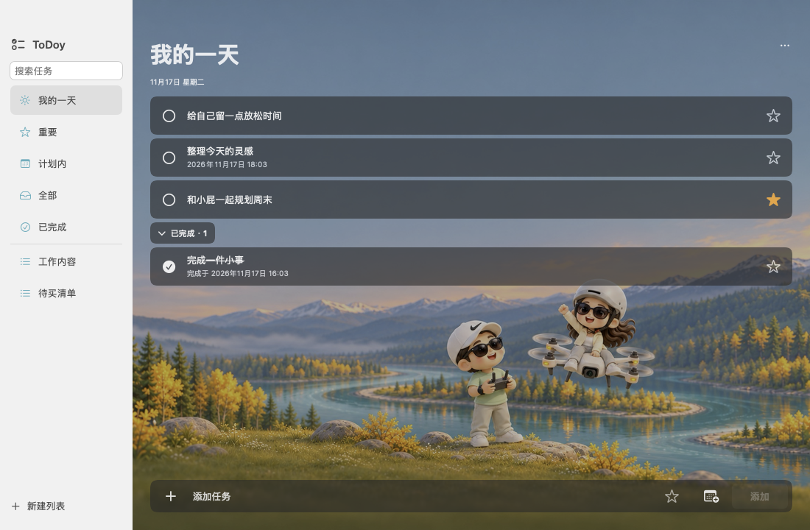
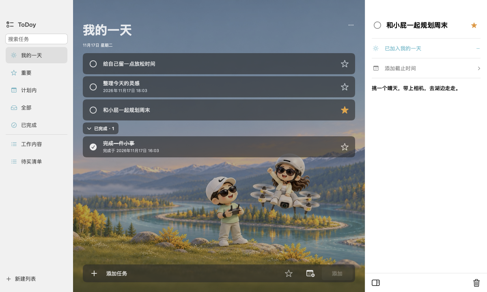

<div align="center">

# ToDoy

把今天的待办，放在喜欢的风景里。

原生 macOS 本地任务管理应用，搭配桌面小组件、GG 和小屁壁纸，以及完成任务时的小小庆祝。

[下载最新版](https://github.com/ZhengYitong2333/ToDoy/releases/latest) · [下载 v1.4.0 DMG](https://github.com/ZhengYitong2333/ToDoy/releases/download/v1.4.0/ToDoy-1.4.0.dmg)

macOS 15+ · Apple Silicon / Intel · SwiftUI / AppKit / WidgetKit

</div>



## 一天，从一件小事开始

新增任务、设置截止日期和时间、标记重要，再把任务安排到「我的一天」。完成时会播放音效并出现彩带，动画结束后再移入已完成分组。

| 功能 | 可以做什么 |
| --- | --- |
| 任务管理 | 新增、编辑、删除、完成和重新打开任务，添加备注 |
| 智能视图 | 我的一天、重要、计划内、全部、已完成 |
| 自定义列表 | 创建、重命名和删除列表，通过右键菜单移动任务 |
| 截止时间 | 快选今天、明天，或指定日期和时间 |
| 任务详情 | 点击任务，在右侧栏编辑内容、重要标记、日期和备注 |
| 排序与显示 | 按重要性、名称、到期日期或创建日期排序，显示或隐藏已完成任务 |
| 搜索 | 跨列表搜索任务标题和备注 |
| 完成反馈 | 音效和彩带动画，保留完成记录和完成时间 |



> 本页界面图由当前视图代码与示例任务渲染。实际字体、颜色和布局会随系统外观及窗口尺寸变化。

## 桌面上，也能随手记

桌面小组件支持小、中、大三种尺寸，展示待办和截止时间。中、大尺寸点击「+」，会在附近打开轻量输入框，可以直接添加任务、标记重要、选择截止时间。

- 点击任务打开主程序的任务详情。
- 中尺寸最多展示 3 项，大尺寸最多展示 9 项，超出时提供「还有 N 项待办」入口。
- 完成提示短暂显示约 8 秒后隐藏，完成记录仍保存在主程序。
- 小组件跟随主程序的背景，也支持同步本地图片。

**添加方式** — 安装并打开 ToDoy 一次，在桌面右键 →「编辑小组件」，搜索「ToDoy」并选择尺寸。

小组件由 macOS 调度刷新，背景同步及提示消失可能略有延迟。其他 Mac 上的扩展识别与加载尚未验证。

## GG 和小屁，陪你完成今天

内置 32 款背景。「GG和小屁」合集收录 12 张壁纸，包含 GG 单人、小屁单人和双人合体场景。


| 合集 | 数量 | 部分主题 |
| --- | --- | --- |
| GG和小屁 | 12 张 | 夜间专注、公司食堂、星空电脑桌、月亮湾、包饺子 |
| 炫酷 | 4 款 | 流动色彩、极光、流光棱镜、霓虹海浪 |
| 田园 | 4 款 | 湖畔晨光、青野、雨后小院、晨光原野 |
| 风景 | 4 张 | 群山、暮色海岸、晨雾湖泊、月下沙丘 |
| 动漫 | 4 张 | 海边列车、雨夜街角、夏日坡道、星空观测站 |
| 科技 | 4 款 | 数字夜幕、星际、翡翠芯片、轨道空间站 |

打开右上角「···」→「更改背景…」，可以选择内置背景、导入本地图片、调整遮罩深浅。


「定时更换」支持每 1、5、15、30 或 60 分钟随机换图，可选择全部背景或某个合集。设置自动保存，手动换图后重新计时。轮换在应用运行期间生效。

## 安装与升级

1. 从 [Releases](https://github.com/ZhengYitong2333/ToDoy/releases/latest) 下载 DMG。
2. 打开安装包，将 ToDoy 拖入 Applications。
3. 打开 ToDoy，按需添加桌面小组件。

安装包包含 Apple Silicon 和 Intel 通用二进制，要求 macOS 15 或以上。Intel 实机运行尚未验证。

当前发布包使用临时签名，未经 Apple 公证。首次打开若被 macOS 拦截，在「系统设置 → 隐私与安全性」中找到对应提示并允许打开。

升级前退出旧版，再替换「应用程序」中的 ToDoy。本机任务和偏好会继续使用。

## 本地数据

任务和列表保存在当前用户的文件中。

```text
~/Library/Application Support/DesktopTodo/tasks.json
```

背景偏好保存在 macOS 用户偏好中，导入的图片位于同一应用支持目录。需要迁移或备份任务时，退出应用后复制 tasks.json，恢复时放回相同位置。

应用采用本地存储。Microsoft To Do 提供了部分交互灵感，Microsoft 账号登录与云端同步尚未实现。

## 从源码构建

需要 macOS、Xcode Command Line Tools，以及构建脚本指定的 macOS 26.5 SDK。脚本当前使用固定 SDK 路径，其他开发环境需要调整。

```bash
git clone https://github.com/ZhengYitong2333/ToDoy.git
cd ToDoy
./script/build_and_run.sh
```

脚本会编译主程序与小组件、生成图标、执行本地数据自检，安装到 /Applications/ToDoy.app 并启动。默认使用临时签名。

生成包含 Apple Silicon 和 Intel 的通用应用包时，指定一个全新的输出目录。

```bash
./script/build_and_run.sh --package dist/ToDoy-release
```

此命令输出 ToDoy.app。发布用 DMG 需要另外封装。

| 文件 | 职责 |
| --- | --- |
| main.swift | 应用生命周期、窗口与任务详情状态 |
| Views.swift | 任务界面、输入区、详情侧栏与菜单 |
| Todo.swift / Store.swift | 数据模型、本地持久化与排序 |
| Backgrounds.swift | 壁纸目录、定时轮换和背景设置 |
| QuickEntry.swift | 小组件快速添加输入框 |
| CompletionBurst.swift | 完成反馈 |
| Widget/Widget.swift | 桌面小组件 |
| Resources/Backgrounds/ | 内置壁纸资源 |

